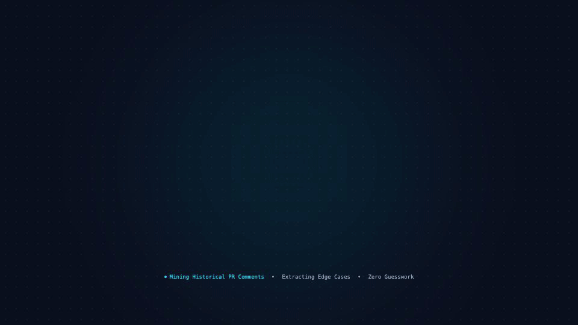

# squad-review

A multi-lane AI code review skill for Claude Code and Antigravity. Five specialized sub-agents run in parallel on every pull request. An adversarial verifier kills false positives before you see them. Comments come out in your senior engineers' voice, not ChatGPT's.

> "AI code review should not check syntax. It should bottle your senior engineers' best instincts, verify them against the actual code, and run them on every commit."



---

## What it does

- **5 parallel review lanes**: code logic, design alignment, test coverage, security, and precedent matching
- **Adversarial verifier**: a sixth agent that argues for the PR author and drops anything below 80% confidence
- **Evidence-gated**: no finding is posted without a grep or file read that actually ran
- **Voice-controlled**: median comment length is 8 words. No hedging, no "Consider", no AI fingerprints
- **Self-learning**: accepted, rejected, and reworded comments feed back into `learnings.json` so the same false positive is never raised twice
- **Safe by default**: nothing is posted to your Git host without explicit per-comment confirmation

---

## Requirements

- [Claude Code](https://claude.ai/code) or [Antigravity](https://antigravity.dev) with sub-agent support
- GitHub CLI (`gh`) or GitLab CLI (`glab`) authenticated for your Git host
- Python 3.9+ (for `annotate_diff.py`, `precedents.py`, `lint_skill.py`)
- `jq` and `curl` (used in the shell scripts)
- Local clones of the repos you want to review (read-only, never modified)
- Optional: Jira/Linear/Notion MCP for the design lane

---

## How the lanes work

```
  PR URL or ID
       |
       v
  [prepare.sh]  <-- fetches diff, threads, pipeline, builds annotated.txt
       |
  [Scope Gate]  <-- skips lanes not warranted by the diff
       |
  ┌────┴──────────────────────────────────────┐
  |      Parallel Lane Agents                 |
  |  code | design | tests | security | prec  |
  └────┬──────────────────────────────────────┘
       |
  [13-step Merge]  <-- dedupe, confidence gate, re-evidence blockers
       |
  [Verifier Agent]  <-- KEEP / DROP / DOWNGRADE_TO_PROBE per finding
       |
  [Chat Output]  <-- never auto-posted. You confirm each comment.
```

---

## Confidence rubric

| Score | Meaning | Action |
|---|---|---|
| 90-100 | Reproduced with grep/file read, impact certain | Blocker finding |
| 80-89 | Strong evidence, small doubt | Finding |
| 60-79 | Plausible but uncertain | Probe (question, never directive) |
| < 60 | Weak signal | Silently dropped |

The verifier cannot KEEP anything below 80.

---

## File structure

```
squad-review/
  README.md               # This file
  SKILL.md                # Orchestrator: reads all support files, runs the pipeline
  review-rules.md         # ~90 rule IDs across 14 categories
  voice.md                # Comment phrasing rules
  mindmap.md              # Review order
  lane-contract.md        # Lane input/output contract and confidence rubric

  agents/
    code.md               # Logic, errors, DB, config, observability, naming
    design.md             # PRD/ADR/spec alignment
    tests.md              # Unit test and BDD coverage map
    precedents.md         # Matches diff patterns against your comment history
    security.md           # PII, auth, input validation, secrets, TLS
    verifier.md           # Adversarial - argues for the PR author

  scripts/
    prepare.sh            # Main setup: fetches diff, builds annotated.txt, context.json
    fetch_mr.sh           # Fetches MR metadata, commits, pipeline status
    annotate_diff.py      # Turns raw diff into old|new| format for line anchoring
    precedents.py         # Matches current diff against squad-comments.json
    notes_api.py          # Wrapper for your Git host notes/comments API
    post_comment.sh       # Posts a comment with dry-run support
    edit_note.sh          # Edits an existing comment by ID
    delete_note.sh        # Deletes a comment by ID
    lint_skill.py         # Validates skill integrity: missing files, broken IDs, bad learnings
    refresh_comments.sh   # Re-fetches your comment corpus from your Git host
    daily_learn.sh        # Runs daily, writes proposals to skill-proposals.md

  data/
    learnings.json        # Start empty: []. Grows as you accept/reject findings
    squad-comments.json   # Your source corpus. Populated by refresh_comments.sh
    squad-threads.json    # Thread context for the corpus comments
    skill-proposals.md    # Auto-generated daily rule improvement proposals
    reviewed/             # One JSON per reviewed PR. Gitignored.
    .gitignore

  setup/
    install.sh            # Interactive setup script
    launchd.plist.tmpl    # macOS launchd template for daily_learn.sh / refresh_comments.sh
    cron.example          # Linux cron equivalent
```

---

## Setup

### 1. Install the skill

```bash
# Clone the repo
git clone https://github.com/YOUR_USERNAME/squad-review.git
cd squad-review

# Run the setup script (interactive)
bash setup/install.sh
```

The install script will:
- Copy `SKILL.md`, `review-rules.md`, `voice.md`, `mindmap.md`, `lane-contract.md` to your Claude skills directory
- Copy `agents/*.md` to your Claude agents directory
- Copy `scripts/` to the skill folder
- Create empty `data/` files
- Ask for your Git host URL and default org

### 2. Clone your repos locally

The skill reads your local clones for cross-file checks. It never modifies them.

```bash
mkdir -p ~/projects
git clone https://your-git-host.com/yourorg/your-repo.git ~/projects/your-repo
# Repeat for any sibling repos you want cross-repo checks on
```

Update the `SIBLING_REPOS` array in `scripts/prepare.sh` with your repo names.

### 3. Authenticate your Git host

**GitHub:**
```bash
gh auth login
```

**GitLab:**
```bash
glab auth login
```

Set `GIT_HOST` in `scripts/prepare.sh` to your instance URL (defaults to `github.com`).

### 4. Build your comment corpus

The precedents lane matches against real review comments from your team. The more history you seed it with, the better.

```bash
# Fetch review comments from the last 90 days
bash scripts/refresh_comments.sh --since 90d --repo yourorg/your-repo
```

This writes `data/squad-comments.json` and `data/squad-threads.json`.

### 5. Set up the daily schedule

**macOS (launchd):**
```bash
# Edit the plist with your paths first
cp setup/launchd.plist.tmpl ~/Library/LaunchAgents/com.squad-review.plist
# Edit paths inside the plist
launchctl load ~/Library/LaunchAgents/com.squad-review.plist
```

**Linux (cron):**
```bash
# See setup/cron.example for the crontab entry
crontab -e
```

### 6. Connect your project management tool (optional)

For the design lane to verify spec alignment, connect your Jira, Linear, or Notion MCP to your Claude config. Without it, the design lane returns partial results and caps all findings at 79 confidence.

See the [Anthropic MCP docs](https://docs.anthropic.com/en/docs/agents/mcp) for setup.

### 7. Validate

```bash
python3 scripts/lint_skill.py
```

Fix every `WARN` before your first review. Then restart your Claude session so the agent files load.

---

## Usage

```
/squad-review https://github.com/yourorg/your-repo/pull/312
/squad-review yourorg/your-repo#312
/squad-review your-repo#312          # org defaults to whatever you set in prepare.sh
/squad-review queue                  # open PRs where you are a reviewer
/squad-review repo:your-repo         # all open non-draft PRs (skips bots)
```

**Flags:**
- `--fast`: skip design and security lanes
- `--nits`: include low-severity style findings
- `--save`: write the full output to data/reviewed/
- `--brief`: summary only, no per-line breakdown

---

## Posting comments

The skill never auto-posts. Output always lands in chat first.

When you are ready to post:
1. Read the output
2. Name the specific comments you want posted
3. The skill restates exact text and location
4. You confirm
5. `post_comment.sh --dry-run` runs first, shows you the anchor, line, and body
6. After your go-ahead, it posts for real
7. `POSTED <link>#comment_<id>` means it landed. Anything else means it did not.

Post one comment first. Check it in the UI. Then post the rest.

Approval for one PR never carries over to another.

---

## Customising the rules

`review-rules.md` has ~90 rules out of the box. To add your own:

1. Pick an unused ID in the right group (e.g., `ERR-014`)
2. Add: what to look for, mandatory verify step, example comments, weight (High/Medium)
3. Run `python3 scripts/lint_skill.py` - it will catch duplicate IDs and missing fields
4. Restart your session

To retire a rule permanently, set `weight: Retired` instead of deleting it. Deleting breaks the learnings log if that rule ID was ever recorded.

---

## The learning loop

When you reject, reword, or accept a finding, Claude appends to `data/learnings.json`:

```json
{
  "date": "2026-10-16",
  "repo": "payment-service",
  "pr": "312",
  "rule": "ERR-003",
  "kind": "rejected",
  "before": "user can be null after find(). Add guard.",
  "after": null,
  "note": "null handled upstream in the repository layer"
}
```

Lanes and the verifier read this file. A rejected finding is never raised again in the same context.

`daily_learn.sh` writes rule improvement proposals to `data/skill-proposals.md`. You review and apply them. The skill proposes, you decide. It never edits its own rules.

---

## Hard constraints (do not change these)

These are in `SKILL.md` and the verifier enforces them:

1. Never write to Jira, Confluence, or any ticketing system.
2. Never post to your Git host without: you saw the output, you named the comment, the skill restated exact text and location, you confirmed.
3. Never modify local clones. `git fetch` and read commands only. No `checkout`, `pull`, `reset`, `stash`, `rebase`, `commit`.
4. Every finding requires evidence that was actually executed. Not inferred, not assumed.
5. Deduplicate against all existing threads (human, bot, outdated, resolved).
6. No AI fingerprints in comment text. No "Consider", no praise, no emoji, no hedging.

---

## Adapting for your team

After setup, these are the things you should personalise:

| What | Where | What to change |
|---|---|---|
| Your org and repos | `scripts/prepare.sh` | `GIT_HOST`, `DEFAULT_ORG`, `SIBLING_REPOS` |
| Local clone paths | `scripts/prepare.sh` | `CLONE_BASE_DIR` |
| Design lane spec tool | `agents/design.md` | MCP tool name and search space |
| Voice baseline | `voice.md` | Run on your own team's real comments |
| Rule catalogue | `review-rules.md` | Add domain-specific rules, retire irrelevant ones |
| Who reads the output | `SKILL.md` (Calibration section) | Your team's context, language, seniority |

---

## Known issues

- `review-rules.md` and `voice.md` may disagree on corpus sizes in comments. The difference is raw count vs substantive-only count. Both are correct for their context.
- New agent files only load at session start. If you add or edit an agent, restart your session before the next review.
- GitLab list endpoints cap at 100 per page and truncate silently. `refresh_comments.sh` paginates automatically. GitHub's REST API has similar limits.

---

## Contributing

Bug reports, new rule ideas, and script improvements are welcome.

Use the issue templates:
- `Bug report` - something broke
- `Rule proposal` - a pattern your team catches that is not in the catalogue

Before opening a PR, run `python3 scripts/lint_skill.py` and fix all warnings.

---

## License

MIT. Do whatever you want. Credit is nice but not required.
